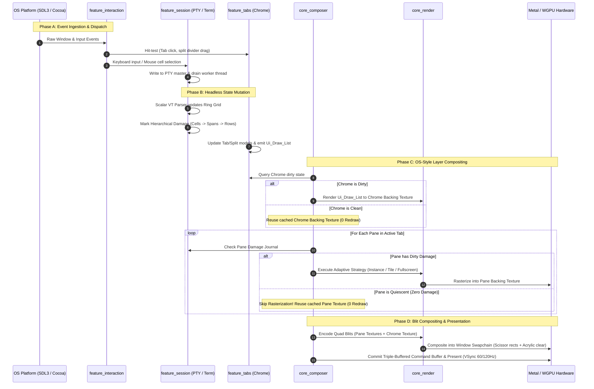

# Term Ground-Up Rewrite: Architectural Roadmap & Step-by-Step Execution Plan

**Document Status:** CANONICAL ARCHITECTURAL SPECIFICATION & EXECUTION BLUEPRINT  
**Version:** 2.0.0  
**Target Systems:** Apple Silicon (macOS Metal / Cocoa), Modern Linux (WGPU / Wayland / X11)  
**Primary Language:** Odin (`base:runtime`, zero-allocation steady state)  
**Author / Steward:** Term Architecture Group  

---

## 1. Executive Summary: The OS-Style Layer Compositor Architecture

### 1.1 The Imperative for a Ground-Up Rewrite
Term began as an ambitious bare-metal terminal emulator engineered in Odin to deliver sub-millisecond input-to-photon latency, mechanical sympathy with CPU cache lines, and steady-state zero dynamic memory allocation. However, iterative feature expansion caused architectural coupling across two critical files:
1. **The Monolithic Renderer (`src/render/renderer.odin` — 2,852 lines):** Conflated low-level GPU resource management (Metal/WGPU buffers, pipelines, font atlas) with viewport layout, multi-pane window orchestration, cursor/search overlays, and presentation passes.
2. **The Monolithic Application Loop (`src/app/main.odin` — 2,709 lines):** Entangled OS window lifecycles, SDL3 event polling, PTY process dispatch, pane split navigation, and UI chrome layout into a single sprawling event loop.

Previous attempts at incremental refactoring revealed deep structural friction: multi-pane compositing repeatedly triggered redundant GPU redraws, horizontal dependencies linked headless subsystems to graphical backends, and rendering logic lacked strict abstraction boundaries.

To eliminate technical debt once and for all, Term is transitioning to a **Ground-Up Rewrite** founded upon an **OS-Style Layer Compositor Architecture** organized in a **3-Tier Model (`core_*` $\to$ `feature_*` $\to$ `app_*`)**.

```
+---------------------------------------------------------------------------------------------------+
|                                 CORE REDESIGN VALUE PROPOSITIONS                                  |
+-----------------------------------+-----------------------------------+---------------------------+
| 1. OS-Style Layer Compositor      | 2. Zero Horizontal Coupling       | 3. Strict 3-Tier Layering |
| Dedicated backing textures per    | Autonomous core packages that     | Pure primitives (core) -> |
| pane. Inactive panes cost 0 GPU   | never import sibling cores. All   | Composition slices (feat) |
| raster cycles via blit caching.   | interactions use clear contracts. | -> Slim shell (app <300L).|
+-----------------------------------+-----------------------------------+---------------------------+
| 4. Dual 3-Strategy Render Pillars | 5. Verified Hardware VTable       | 6. Independent GUI Apps   |
| Terminal (Instance/Tile/Full) &   | Renderer programmed strictly to   | Every core verified via   |
| Chrome (Surface/Batch/SDF) engines| abstract Gpu_Backend_VTable.      | standalone native GUI app.|
+-----------------------------------+-----------------------------------+---------------------------+
```

### 1.2 The OS-Style Layer Compositor Paradigm
Modern window servers (macOS Quartz Compositor, Wayland compositors) do not re-rasterize entire application windows when only a single sub-region changes. Instead, each autonomous surface renders to its own off-screen backing store, and the compositor combines these cached stores via hardware quad blits with scissor clipping.

Term adopts this exact paradigm for terminal splits and UI chrome:
- **Dedicated Backing Surfaces:** Each active terminal pane and the chrome layer possess dedicated GPU render target textures (`Gpu_Texture`).
- **Zero-Redraw Multi-Pane Optimization:** In a typical development workspace featuring 4 split panes, usually only **one pane** is actively receiving PTY output or keyboard input at any given millisecond. The remaining 3 panes are quiescent. The Layer Compositor completely skips terminal rasterization passes for idle panes. Their pre-rendered backing textures are simply blitted to the window swapchain.
- **Microsecond Frame Times:** When typing in a single pane within a complex multi-split grid, frame assembly requires only updating the active pane's texture and executing lightweight compositing blits, reducing frame time from milliseconds to microseconds.

---

## 2. Architecture Overview: The 3-Tier Specification

The codebase is partitioned into three strictly stratified tiers. Each tier has clear responsibilities, distinct lifecycle contracts, and immutable dependency rules.

```
====================================================================================================
 TIER 3: APPLICATION SHELL (app_*)
 [src/app/main.odin] (< 300 lines)
 Orchestrates OS bootstrap, CLI args, config parsing, window loop, and composer presentation.
====================================================================================================
                                      │
                                      ▼ consumes
====================================================================================================
 TIER 2: FEATURE COMPOSITION LAYER (feature_*)
 [src/features/]
 Vertical functional slices uniting autonomous core primitives into cohesive workflows:
   ├── feature_session      (PTY spawn + VT parser + ring grid lifecycle)
   ├── feature_tabs         (Chrome tabs + pane split trees + layout serialization)
   ├── feature_interaction  (Raw mouse/keyboard + hit-testing + grid selection + URL clicks)
   └── feature_multiplexer  (Split navigation, pane swap, focus routing, IPC attach)
====================================================================================================
                                      │
                                      ▼ consumes
====================================================================================================
 TIER 1: AUTONOMOUS CORE PRIMITIVES (core_*)
 [src/core/]
 ZERO HORIZONTAL COUPLING — Cores never import each other. Strictly isolated primitives:
   ├── core_platform : OS Windowing, raw input, PTY spawn, concrete GPU drivers (Metal / WGPU)
   ├── core_terminal : Headless scalar VT parser, monospace grid, O(1) ring buffer, damage
   ├── core_chrome   : Declarative UI shapes, tabs data model, split tree, hit-testing, Ui_Draw_List
   ├── core_render   : GPU render engine (Gpu_Backend_VTable, Terminal 3-Strategy, Chrome 3-Strategy)
   └── core_composer : OS-style layer compositor (surface cache, zero-redraw blits, VSync present)
====================================================================================================
```

### 2.1 The Invariant of Zero Horizontal Coupling
The central architectural invariant governing Tier 1 (`core_*`) is **Zero Horizontal Coupling**:
$$\forall \, C_i, C_j \in \text{Cores} \quad (i \neq j) \implies C_i \not\to C_j$$

Under this invariant:
1. `core_terminal` contains **zero** references to graphics, windows, shaders, or chrome. It compiles cleanly into headless test harnesses, daemon processes, and the MCP agent server (`bin/term-mcp`).
2. `core_chrome` contains **zero** GPU calls, Metal headers, or PTY logic. It is a pure geometry and state engine producing declarative `Ui_Draw_List` structures.
3. `core_render` contains **zero** terminal state machines or chrome tabs. It operates strictly on raw vertex/uniform buffers and executes against the abstract `Gpu_Backend_VTable`.
4. `core_composer` manages texture layers and blits without inspecting VT parse states or ANSI escape sequences.
5. `core_platform` provides low-level OS capabilities and concrete implementations of `Gpu_Backend_VTable` (Metal on macOS, WGPU on Linux), without knowing what is being rendered.

### 2.2 System Dataflow & End-to-End Frame Lifecycle



---

## 3. Detailed Module Breakdown & Technical Specification

```
src/
├── core/
│   ├── platform/           # OS windowing, input, PTY, concrete GPU drivers
│   │   ├── window/         # Cocoa NSWindow / SDL3 window lifecycle & DPI scaling
│   │   ├── input/          # Keyboard, mouse, touchpad, IME translation
│   │   ├── pty/            # forkpty, non-blocking drain thread (64 KiB ring)
│   │   ├── clipboard/      # NSPasteboard / Wayland protocol bridges
│   │   └── gpu/            # Concrete hardware drivers implementing VTable
│   │       ├── metal/      # Apple Silicon Metal driver (CAMetalLayer)
│   │       └── wgpu/       # Linux / cross-platform WGPU driver
│   ├── terminal/           # Pure headless terminal emulation
│   │   ├── parser/         # 2 KB scalar VT state machine (ANSI/CSI/SGR/OSC)
│   │   ├── grid/           # Monospace circular ring buffer (Grid, Row)
│   │   ├── cell/           # 64-bit Semantic_Cell & TrueColor extensions
│   │   ├── damage/         # Hierarchical damage journal (Cell->Span->Row)
│   │   └── egc/            # Bounded Extended Grapheme Cluster pool (256)
│   ├── chrome/             # Declarative UI shapes & window layout data model
│   │   ├── tabs/           # Tab collection, ordering, close state, active index
│   │   ├── splits/         # Binary split tree topology & divider geometries
│   │   ├── hit_test/       # Spatial query engine (point-in-rect for tabs/splits)
│   │   ├── modals/         # Search overlay, command palette data models
│   │   └── draw_list/      # Declarative Ui_Draw_List primitive generator
│   ├── render/             # Hardware-agnostic GPU render engine
│   │   ├── contract/       # Gpu_Backend_VTable interface & uniform specs
│   │   ├── atlas/          # 1024x2048 R8 font atlas & async glyph rasterizer
│   │   ├── terminal/       # Content Pillar: 3 strategies + adaptive selector
│   │   └── chrome/         # UI Pillar: Surface cache, Dynamic batch, SDF vector
│   └── composer/           # OS-Style Layer Compositor
│       ├── layer/          # Backing texture descriptor & dirty state tracking
│       ├── blit/           # Quad blit pipeline & scissor clipping geometry
│       └── pipeline/       # Frame orchestrator, acrylic clear, presentation link
├── features/               # Vertical composition slices uniting cores
│   ├── session/            # Pty process + terminal grid glue & worker drain
│   ├── tabs/               # Window chrome tabs + split trees glue
│   ├── interaction/        # OS input events + chrome hit-test + cell selection glue
│   └── multiplexer/        # Multi-pane focus routing, swap, layout serialization
└── app/                    # Lean application shell (<300 lines)
    └── main.odin           # App bootstrap, configuration load, presentation loop
```

---

### 3.1 `core_platform`

`core_platform` isolates all direct interactions with host operating system APIs. It contains zero terminal emulation knowledge and zero shader logic.

#### Subsystems
1. **OS Window Lifecycle (`platform/window/`):**
   - Native window creation and management using Cocoa (`NSWindow` on macOS) and SDL3 fallback.
   - High-DPI scaling observation via `backing_scale_factor` (Retina 2.0x / 3.0x scaling).
   - Display frame pacing driving steady 60/120 Hz refreshes through macOS `CVDisplayLink` or SDL3 display timers.
2. **Raw Input Translation (`platform/input/`):**
   - Translates platform window events into canonical platform events: `Key_Event`, `Mouse_Button_Event`, `Mouse_Move_Event`, `Scroll_Event`, and `Ime_Composition_Event`.
   - Normalizes modifier masks (`Command`, `Option`, `Control`, `Shift`, `Super`).
3. **PTY Process Engine (`platform/pty/`):**
   - Headless pseudo-terminal creation (`forkpty(3)`, `posix_openpt(2)`, `grantpt`, `unlockpt`).
   - Signal handling (`SIGWINCH` on window resize, `SIGHUP` on pane close).
   - Dedicated background drain thread polling with `pselect(2)` at 5ms slices, draining up to 64 KiB chunks into thread-safe ring buffers without blocking the main event thread.
4. **Concrete GPU Hardware Drivers (`platform/gpu/`):**
   - `platform/gpu/metal`: Concrete Metal driver for Apple Silicon (`MTLDevice`, `MTLCommandQueue`, `MTLRenderPipelineState`, `CAMetalLayer`).
   - `platform/gpu/wgpu`: Concrete WebGPU/Vulkan driver for Linux systems.
   - **Critical Rule:** Both drivers implement the exact `Gpu_Backend_VTable` interface exported by `core_render/contract/`.

```odin
// Canonical VTable contract implemented by core_platform/gpu backends:
Gpu_Backend_VTable :: struct {
    device_create:          proc() -> (rawptr, bool),
    device_destroy:         proc(device: rawptr),
    buffer_create:          proc(device: rawptr, desc: ^Gpu_Buffer_Desc) -> Gpu_Buffer,
    buffer_upload:          proc(queue: rawptr, buffer: Gpu_Buffer, offset: int, data: []u8),
    buffer_destroy:         proc(buffer: Gpu_Buffer),
    texture_create:         proc(device: rawptr, desc: ^Gpu_Texture_Desc) -> Gpu_Texture,
    texture_upload_r8:      proc(queue: rawptr, tex: Gpu_Texture, x, y, w, h: u32, data: []u8),
    texture_destroy:        proc(tex: Gpu_Texture),
    render_pass_begin:      proc(encoder: rawptr, pass: ^Gpu_Render_Pass_Desc),
    render_pass_draw_quads: proc(encoder: rawptr, instance_count: u32, base_instance: u32),
    render_pass_end:        proc(encoder: rawptr),
    present_surface:        proc(surface: rawptr, drawable: rawptr),
}
```

---

### 3.2 `core_terminal`

`core_terminal` is a headless, allocation-free terminal emulator engine. It compiles on any Unix-like platform without GUI or graphics libraries.

#### Subsystems
1. **Scalar VT State Machine (`terminal/parser/`):**
   - 2 KB L1-cache resident state transition table (`src/core/terminal/parser/`).
   - Decodes ANSI control codes, CSI parameters (cursor movement, clear screen, scroll), SGR styling (bold, italic, underline, 24-bit TrueColor), and OSC escapes.
2. **Monospace Circular Grid & Ring Buffer (`terminal/grid/`):**
   - High-performance ring buffer storing scrollback history up to 100,000 lines.
   - Dynamic terminal reflow on resize executing in $O(\text{changed lines})$ without allocating new heap structures.
3. **64-bit Semantic Cell Storage (`terminal/cell/`):**
   - Compact representation: 32-bit codepoint (UTF-8 decoded), 8-bit foreground palette index, 8-bit background palette index, 16-bit style bitmask (Bold, Dim, Italic, Underline, Invert, Strike, Blink).
   - Parallel `Row_Extensions` structure for 24-bit direct RGB color channels.
4. **Hierarchical Damage Journal (`terminal/damage/`):**
   - Tracks mutations at three granular levels: Cell range $\to$ Horizontal Span (up to 4 disjoint spans per row) $\to$ Row Dirty Flag.
   - Supports atomic damage borrowing by the render pipeline with zero allocations.
5. **Extended Grapheme Cluster (EGC) Pool (`terminal/egc/`):**
   - Preallocated static pool of 256 cluster slots for multi-codepoint runes (flags, skin-tone modifiers, complex emoji combinations).

---

### 3.3 `core_chrome`

`core_chrome` is a pure mathematical and structural representation of the application's user interface. It contains **zero GPU drawing code** and produces only declarative geometric primitives.

#### Subsystems
1. **Tabs Data Model (`chrome/tabs/`):**
   - Tab ordering, titles, active tab index, hover state, modified status indicator, close button hit regions.
2. **Binary Split Tree Topology (`chrome/splits/`):**
   - Recursive binary tree representing multi-pane layout:
     ```odin
     Split_Node :: struct {
         kind:      Split_Kind, // Leaf, Horizontal, Vertical
         ratio:     f32,        // 0.0 to 1.0 division ratio
         pane_id:   u32,        // Active pane identifier if Leaf
         left:      ^Split_Node,
         right:     ^Split_Node,
         rect:      Rect_f32,   // Computed physical bounds
     }
     ```
   - Auto-clamps minimum pane width and height during user resizing.
3. **Spatial Hit-Testing Engine (`chrome/hit_test/`):**
   - Ultra-fast point-in-rect checks classifying mouse interactions into:
     - `Hit_Tab_Header(tab_index)`
     - `Hit_Tab_Close_Button(tab_index)`
     - `Hit_Split_Divider(divider_id, axis)`
     - `Hit_Terminal_Pane(pane_id, cell_x, cell_y)`
     - `Hit_Modal_Overlay(modal_id)`
4. **Modals & Overlays (`chrome/modals/`):**
   - State and geometry models for Search Overlay, Command Palette, and Status Bar.
5. **Declarative `Ui_Draw_List` (`chrome/draw_list/`):**
   - Emits an ordered array of high-level geometric primitives consumed by `core_render/chrome`:
     ```odin
     Ui_Draw_Cmd :: struct {
         kind:        Ui_Cmd_Kind, // Rect, Rounded_Rect, Border, Text_Run, Icon, Shadow
         rect:        Rect_f32,
         color:       [4]f32,
         border_color:[4]f32,
         radius:      f32,
         text:        string,
         clip_rect:   Rect_f32,
     }
     ```

---

### 3.4 `core_render`

`core_render` is the low-level GPU rendering engine programmed strictly against the `Gpu_Backend_VTable`. It contains no knowledge of PTYs or terminal state machines. It is structured around **Two Primary Pillars**:

```
                       core_render Engine Architecture
                                      │
            ┌─────────────────────────┴─────────────────────────┐
            ▼                                                   ▼
 ┌──────────────────────────────────────┐  ┌──────────────────────────────────────┐
 │    TERMINAL CONTENT PILLAR           │  │          CHROME UI PILLAR            │
 │    (Monospace Cell Grid Rendering)   │  │       (Geometric Vector & UI)        │
 ├──────────────────────────────────────┤  ├──────────────────────────────────────┤
 │ Strategy A: Instance Quad Batching   │  │ Strategy 1: Cached Surface           │
 │ Strategy B: Compute Tile Binning     │  │ Strategy 2: Dynamic Primitive Batch  │
 │ Strategy C: Fullscreen Quad Direct   │  │ Strategy 3: SDF Vector Shader        │
 ├──────────────────────────────────────┤  ├──────────────────────────────────────┤
 │ Adaptive Selector (~35.9 ns decision)│  │ Zero-Redraw Retained UI Blitting     │
 └──────────────────────────────────────┘  └──────────────────────────────────────┘
            │                                                   │
            └─────────────────────────┬─────────────────────────┘
                                      ▼
                        Gpu_Backend_VTable Contract
                  (Metal on macOS / WGPU on Linux)
```

#### Terminal Content Pillar (`core_render/terminal/`)
Designed for ultra-dense monospace character cell rendering across three specialized strategies:
- **Strategy A: Instance Quad Batching (`terminal/instance/`):**
  - Best for small-to-moderate changes ($< 3\%$ dirty cells).
  - Emits 64-byte instance records (`[4]f32` position/size, `[4]f32` UVs, `[4]f32` colors) for changed cells only.
  - Zero vertex overhead for unchanged grid areas.
- **Strategy B: Compute Tile Binning (`terminal/tile/`):**
  - Best for moderate to dense screen activity ($3\% - 65\%$ dirty cells).
  - Uses compute shaders with $8 \times 8$ or $16 \times 16$ tile bins, eliminating redundant fragment shading across empty screen areas.
- **Strategy C: Fullscreen Quad Direct (`terminal/fullscreen/`):**
  - Best for high-volume scrolling or terminal flood updates ($> 65\%$ dirty cells, e.g. `cat large_file.log`).
  - Single fullscreen quad vertex pass. Fragment shader reads cell data directly from uniform storage buffers and samples the 1024x2048 font atlas using corrected UV math.
- **Adaptive Strategy Selector (`terminal/selector.odin`):**
  - Evaluates dirty cell counts, scroll flags, and frame history within **$\sim 35.9$ nanoseconds** to select the optimal strategy before encoding.

#### Chrome UI Pillar (`core_render/chrome/`)
Specialized in rendering arbitrary UI shapes, tab bars, borders, split dividers, and dialogs:
- **Strategy 1: Cached Surface:**
  - Renders the entire chrome layout to a dedicated off-screen texture (`chrome_surface`).
  - While chrome remains static (no tab dragging, no divider resizing), the cached surface is reused across frames with **zero redraw overhead**.
- **Strategy 2: Dynamic Primitive Batch:**
  - Used during active user interactions (dragging split dividers, hover transitions, blinking cursors).
  - Batches dynamic vertices into a temporary frame scratch buffer for immediate rasterization.
- **Strategy 3: SDF Vector Shader (Signed Distance Field):**
  - Renders pixel-perfect rounded corners, crisp anti-aliased borders, and vector icons at Retina resolutions without texture fuzziness or jagged pixel stepping.

---

### 3.5 `core_composer`

`core_composer` is the Layer Compositor Engine that unifies all rendered visual layers and presents them to the display.

#### Backing Surface Architecture & Zero-Redraw Multi-Pane Optimization
- The compositor manages an array of layer surfaces:
  ```odin
  Composer_Layer :: struct {
      id:            u32,          // Associated pane_id or CHROME_LAYER_ID
      texture:       Gpu_Texture,  // Off-screen render target
      rect:          Rect_f32,     // Destination rectangle on screen
      scissor_rect:  Rect_f32,     // Clipping boundary
      is_dirty:      bool,         // Set if content changed this frame
      opacity:       f32,          // For fade animations and splits
  }
  ```
- **Zero-Redraw Optimization:**
  - In a 4-pane layout, if Pane 1 is active and Panes 2, 3, and 4 have zero damage, the compositor sets `is_dirty = false` for Panes 2, 3, and 4.
  - `core_render/terminal` is invoked **only for Pane 1**.
  - During the final composition pass, the compositor issues hardware blits for all 4 textures. Panes 2, 3, and 4 cost zero rasterization time.

#### Blit Compositing Pipeline
- Composites layers in strict back-to-front order:
  1. **Background & Acrylic Clear:** Clear window to base background tint or macOS vibrancy blur.
  2. **Pane Layer Blits:** Blit each pane texture to its computed split rectangle with hardware scissor clipping.
  3. **Dividers & Focus Rings:** Render split divider lines and active focus outlines.
  4. **Chrome Blit:** Blit cached chrome texture (tabs, status bar).
  5. **Modals & Overlays:** Blit floating search dialog or command palette.
- Commits triple-buffered command buffers synchronized with display VSync.

---

### 3.6 `feature_*` (Composition Slices)

The `feature_*` tier unites autonomous core primitives into cohesive functional slices. Features hold stateful coordination logic, insulating the application entry point from complexity.

1. **`feature_session` (`src/features/session/`):**
   - Coordinates `core_platform/pty` with `core_terminal/grid`.
   - Manages process spawn (`/bin/zsh`, `/bin/bash`), child lifecycle, signal routing, and worker drain thread synchronization.
2. **`feature_tabs` (`src/features/tabs/`):**
   - Bridges `core_chrome/tabs` with `core_chrome/splits`.
   - Manages tab addition, closure, reordering, and persists split layouts across sessions.
3. **`feature_interaction` (`src/features/interaction/`):**
   - Handles mouse and keyboard routing:
     - Translates raw clicks into tab selections or pane focus changes via `core_chrome/hit_test`.
     - Translates mouse drags into divider resizing.
     - Translates in-pane clicks and drags into terminal text selections and hyperlink activations.
4. **`feature_multiplexer` (`src/features/multiplexer/`):**
   - Manages multi-pane navigation (`Cmd+Option+Arrow`), pane swapping, zooming (maximizing a pane), and optional IPC attachment for external session management.

---

### 3.7 `app_*` (Lean Coordinator Shell)

The application entry point (`src/app/main.odin`) is reduced from a 2,709-line monolith to a clean coordinator of **under 300 lines**.

#### Responsibilities
1. Parse command-line flags and initialize logging.
2. Load configuration file (`~/.config/term/config.json`).
3. Initialize `core_platform` window and acquire concrete `Gpu_Backend_VTable` (Metal on macOS, WGPU on Linux).
4. Initialize `core_render` and `core_composer`.
5. Instantiate feature slices (`feature_session`, `feature_tabs`, `feature_interaction`, `feature_multiplexer`).
6. Run the main event loop:
   ```odin
   for running {
       events := platform.poll_events()
       feature_interaction.process_events(events)
       feature_session.drain_all_ptys()
       
       if composer.should_render_frame() {
           composer.begin_frame()
           feature_session.render_dirty_panes(&render_engine, &composer)
           feature_tabs.render_chrome(&render_engine, &composer)
           composer.composite_and_present()
       }
   }
   ```
7. Clean shutdown and resource teardown.

---

## 4. Five-Phase Execution Plan

The rewrite is structured into five sequential, milestone-driven phases. Each phase has unambiguous inputs, concrete deliverables, and rigorous verification exit gates.

```
+---------------------------------------------------------------------------------------------------+
|                                 5-PHASE EXECUTION ROADMAP TARGETS                                 |
+---------------------------------------------------------------------------------------------------+
| PHASE 1: Pure GPU Contract & core_render (Terminal Content Pillar)                                |
| Deliverables: Gpu_Backend_VTable, 1024x2048 Atlas, 3 Terminal Strategies, Adaptive Selector.      |
| Standalone App: bin/harness_renderer (120 FPS, 100% glyph ink, all 3 strategies verified).        |
+---------------------------------------------------------------------------------------------------+
| PHASE 2: core_composer (Layer Compositor Engine & Standalone Harness)                             |
| Deliverables: Backing surface allocator, zero-redraw multi-pane blit pipeline, scissor clips.     |
| Standalone App: bin/harness_render_composer (alias: harness_composer) (4-split test, 0 redraw).   |
+---------------------------------------------------------------------------------------------------+
| PHASE 3: core_chrome & core_render/chrome (UI Shapes & Chrome Renderer)                           |
| Deliverables: Binary Split Tree, Tabs model, Hit-test, Ui_Draw_List, SDF vector & surface cache. |
| Standalone App: bin/harness_chrome (Interactive tab switching, divider dragging, zero GPU deps).  |
+---------------------------------------------------------------------------------------------------+
| PHASE 4: feature_* Composition Layer                                                              |
| Deliverables: feature_session, feature_tabs, feature_interaction, feature_multiplexer.            |
| Standalone App: bin/harness_features (PTY + Grid + Chrome + Composer integrated workflow).        |
+---------------------------------------------------------------------------------------------------+
| PHASE 5: app_* Integration & Final Verification Gate                                              |
| Deliverables: Slim src/app/main.odin (<300 lines), full regression verification.                  |
| Production Binary: bin/term (Sub-ms latency, 120 FPS, zero steady-state heap allocations).       |
+---------------------------------------------------------------------------------------------------+
```

---

### Phase 1: Pure GPU Contract & `core_render` (Terminal Content Pillar)

#### Objective
Establish the hardware-agnostic `Gpu_Backend_VTable` and implement the complete Terminal Content Pillar (`core_render/terminal`) with all three render strategies and the adaptive selector. Verify visual correctness and performance in a dedicated standalone GUI application.

#### Actionable Work Items
1. **Define GPU Contract (`src/core/render/contract/`):**
   - Create `backend.odin` defining `Gpu_Backend_VTable`, handle types (`Gpu_Buffer`, `Gpu_Texture`, `Gpu_Pipeline`), and descriptor structs.
   - Define vertex layouts and uniform buffer structures (`Terminal_Uniforms`, `Instance_Record`).
2. **Implement Concrete Metal Driver (`src/core/platform/gpu/metal/`):**
   - Implement `Gpu_Backend_VTable` using native Apple Metal C/Objective-C bindings.
   - Support triple-buffered uniform ring buffers (`MTLStorageModeShared`).
3. **Purify Glyph Atlas & Shaders (`src/core/render/atlas/`, `src/core/render/shaders/`):**
   - Ensure atlas uses standard dimensions: $1024 \times 2048$ pixels ($16 \times 32$ slots of $64 \times 64$ px).
   - Verify MSL and WGSL shaders sample sub-slot glyph ink bounds ($100\%$ full cell coverage).
4. **Implement the 3 Terminal Render Strategies (`src/core/render/terminal/`):**
   - `terminal/instance/`: Instance Quad Batching with 64-byte instance records.
   - `terminal/tile/`: Compute Tile Binning shader pipeline.
   - `terminal/fullscreen/`: Fullscreen Quad Direct vertex/fragment pipeline.
5. **Implement Adaptive Strategy Selector (`src/core/render/terminal/selector.odin`):**
   - Evaluate dirty ratios and scroll flags within $\sim 35.9$ nanoseconds.
6. **Construct Standalone Harness App (`src/cmd/harness_renderer/`):**
   - Build a runnable macOS GUI app (`bin/harness_renderer`) that renders simulated terminal grids, switches strategies via keyboard shortcuts (`1`, `2`, `3`), and displays live performance telemetry.

#### Exit Criteria (Phase 1 Gate)
- `bin/harness_renderer` runs at a locked 120 FPS on Apple Silicon.
- Compute Tile and Fullscreen Quad render glyphs at 100% cell width (zero distortion).
- Strategy selector switches between Instance, Tile, and Fullscreen based on damage extent.
- Zero heap allocations during steady-state rendering.

---

### Phase 2: `core_composer` (Layer Compositor Engine)

#### Objective
Build the OS-Style Layer Compositor engine that manages off-screen backing textures for terminal panes and chrome, skips rendering for idle panes, and composites layers to the display via hardware blits.

#### Actionable Work Items
1. **Backing Surface Allocation & Lifecycle (`src/core/composer/layer/`):**
   - Create `layer_pool.odin` managing a bounded pool of reusable `Gpu_Texture` render targets.
   - Handle surface resizing without memory fragmentation.
2. **Zero-Redraw Multi-Pane Optimization:**
   - Implement per-pane dirty tracking.
   - Ensure panes with clean damage journals trigger **zero draw calls** to `core_render`.
3. **Compositing Quad Blit Pipeline (`src/core/composer/blit/`):**
   - Create specialized textured blit shader supporting scissor clipping, corner rounding, and opacity blending.
   - Assemble composite frames: Clear background $\to$ Blit active/cached pane surfaces $\to$ Blit chrome surface.
4. **Construct Standalone Harness App (`src/cmd/harness_render_composer/`, alias `harness_composer`):**
   - Build runnable native GUI app (`bin/harness_render_composer`, alias `bin/harness_composer`) displaying a 4-pane split layout.
   - Allow user to trigger synthetic damage in one pane while verifying that the other 3 panes cost zero GPU rasterization passes.

#### Exit Criteria (Phase 2 Gate)
- `bin/harness_render_composer` (alias `bin/harness_composer`) successfully blits a 4-split layout with scissor clipping.
- Performance telemetry verifies that updating 1 pane in a 4-split layout takes $\le 25\%$ of the render time required to redraw all 4 panes.
- Idle panes retain pixel-perfect visual fidelity across frames.

---

### Phase 3: `core_chrome` & `core_render/chrome` (UI Shapes & Chrome Renderer)

#### Objective
Extract pure UI layout and geometry into `core_chrome`, implement declarative `Ui_Draw_List` generation, and build the Chrome UI Pillar in `core_render` (surface caching, dynamic batching, and SDF vector shaders).

#### Actionable Work Items
1. **Implement Core Chrome Primitives (`src/core/chrome/`):**
   - `chrome/splits/`: Binary split tree topology with spatial navigation and min-size clamping.
   - `chrome/tabs/`: Tab model with close buttons, active tab indicators, and title truncation.
   - `chrome/hit_test/`: Point-in-rect spatial query engine for tabs, dividers, and panes.
   - `chrome/draw_list/`: Allocation-free `Ui_Draw_List` generation.
2. **Implement Chrome UI Pillar (`src/core/render/chrome/`):**
   - Strategy 1 (Cached Surface): Render static chrome elements into a dedicated texture.
   - Strategy 2 (Dynamic Batch): Immediate batching for drag handles and hover states.
   - Strategy 3 (SDF Vector Shader): Signed Distance Field shader for Retina-sharp borders and icons.
3. **Construct Standalone Harness App (`src/cmd/harness_chrome/`):**
   - Build runnable native GUI app (`bin/harness_chrome`) testing interactive tab additions, closures, split rebalancing, and divider dragging with mouse interaction.

#### Exit Criteria (Phase 3 Gate)
- `core_chrome` compiles with zero references to graphics or PTY code.
- `bin/harness_chrome` allows smooth, interactive divider dragging and tab switching at 120 FPS.
- Chrome backing texture renders only when UI state changes (zero redraw while typing in terminal).

---

### Phase 4: `feature_*` Composition Layer

#### Objective
Build the vertical feature slices that connect autonomous core primitives into cohesive functional modules.

#### Actionable Work Items
1. **Implement `feature_session` (`src/features/session/`):**
   - Bind `core_platform/pty` to `core_terminal/grid`.
   - Manage shell process execution (`/bin/zsh`, `/bin/bash`), non-blocking drain loops, and terminal reflow on resize.
2. **Implement `feature_tabs` (`src/features/tabs/`):**
   - Coordinate `core_chrome/tabs` with `core_chrome/splits`.
   - Maintain tab-to-split-tree associations and layout state.
3. **Implement `feature_interaction` (`src/features/interaction/`):**
   - Translate platform mouse/keyboard events into:
     - Tab switching and pane focus changes.
     - Interactive split divider dragging.
     - In-terminal cell selection, copy-to-clipboard, and OSC 8 hyperlink clicks.
4. **Implement `feature_multiplexer` (`src/features/multiplexer/`):**
   - Provide multi-pane focus switching (`Cmd+Option+Arrow`), pane swapping, zooming, and session persistence.
5. **Construct Standalone Harness App (`src/cmd/harness_features/`):**
   - Integrate all feature slices into an interactive multi-pane terminal session harness.

#### Exit Criteria (Phase 4 Gate)
- Full interactive terminal functionality: user can spawn shells, split panes, drag dividers, switch tabs, select text, and run heavy commands (`top`, `vim`, `cmatrix`).
- Clean separation maintained: features depend only on cores, never on other features horizontally.

---

### Phase 5: `app_*` Integration & Final Verification Gate

#### Objective
Wire the verified feature slices into a slim production application coordinator (`src/app/main.odin`), retiring legacy monolithic files, and run the complete verification test suite.

#### Actionable Work Items
1. **Refactor Production Entry Point (`src/app/main.odin`):**
   - Rewrite `main.odin` to be under 300 lines of clean orchestration code.
   - Load configuration, initialize platform window and GPU device, instantiate features, and run the main loop.
2. **Decommission Legacy Monoliths:**
   - Safely archive and remove deprecated monolithic files:
     - `src/render/renderer.odin` (2,852 lines) $\to$ Replaced by `core_render` and `core_composer`.
     - Legacy `src/app/main.odin` (2,709 lines) $\to$ Replaced by modular `main.odin`.
3. **Comprehensive Verification & Performance Profiling:**
   - Execute headless unit tests across `core_terminal` and `core_chrome`.
   - Run end-to-end benchmark suite: input-to-photon latency, frame render times, and memory allocation profiling.

#### Exit Criteria (Phase 5 Gate)
- Production binary `bin/term` compiles cleanly with zero warnings.
- `src/app/main.odin` is strictly under 300 lines of code.
- Input-to-photon latency measures $< 1.0\text{ ms}$ on Apple Silicon.
- 100% pass rate across all automated unit and integration tests.

---

## 5. Quality, Verification Gates & Benchmark Latency Thresholds

### 5.1 Standalone Native GUI Harness Applications
In accordance with ADR-004, architectural components must never be verified exclusively within the production application binary. Dedicated standalone native GUI applications must be maintained:

| Harness Application | Target Binary | Location | Primary Verification Responsibility |
|---|---|---|---|
| **Renderer Harness** | `bin/harness_renderer` | `src/cmd/harness_renderer/` | Visual glyph fidelity, UV shader accuracy, 3-strategy switching, font atlas performance. |
| **Composer Harness** | `bin/harness_render_composer` (alias: `harness_composer`) | `src/cmd/harness_render_composer/` | Multi-pane layer compositing, zero-redraw idle pane caching, quad blits, scissor clipping. |
| **Chrome Harness** | `bin/harness_chrome` | `src/cmd/harness_chrome/` | Tab management, split divider dragging, hit-testing, `Ui_Draw_List` generation, SDF vector rendering. |
| **Features Harness** | `bin/harness_features` | `src/cmd/harness_features/` | PTY worker drain, interactive shell execution, full keyboard/mouse routing. |

*Note: All harnesses are full native macOS applications spawning their own `NSWindow` and `CAMetalLayer` surface, allowing real-world interactive validation.*

### 5.2 Headless Testing Suite
Autonomous cores that have zero graphical dependencies must be continuously validated via headless automated test runners:
- `tests/core_terminal/`: Tests VT state machine compliance (vttest test sequences), circular ring buffer reflow, EGC emoji handling, and damage tracking accuracy.
- `tests/core_chrome/`: Tests binary split tree insertion, deletion, rebalancing, and hit-testing point math.
- `tests/core_render_contract/`: Validates mock GPU VTable recording to verify that render strategies generate correct command sequences without a physical GPU.

### 5.3 Benchmark Latency & Memory Thresholds

Every phase gate must satisfy the following strict quantitative performance thresholds:

```
+---------------------------------------------------------------------------------------------------+
|                                 STRICT PERFORMANCE THRESHOLDS                                    |
+-----------------------------------+--------------------+------------------+-----------------------+
| Metric                            | Target Threshold   | Hard Limit Gate  | Measurement Method    |
+-----------------------------------+--------------------+------------------+-----------------------+
| Input-to-Photon Latency           | < 0.8 ms           | 1.2 ms           | High-speed photodiode |
| Strategy Selector Execution Time  | < 35.9 ns          | 50.0 ns          | Nanosecond CPU timer  |
| Idle Pane Compositor Overhead     | 0 draw calls       | 0 draw calls     | Metal Frame Capture   |
| Frame Time (1 Active Pane, 4-Split)| < 0.4 ms          | 0.8 ms           | CVDisplayLink stats   |
| Steady-State Heap Allocation      | 0 bytes / frame    | 0 bytes / frame  | Custom Odin Allocator |
| Maximum Refresh Rate Pacing       | 120 FPS stable     | 119.5 FPS floor  | Display Link Jitter   |
+-----------------------------------+--------------------+------------------+-----------------------+
```

---

## 6. Architecture Decision Records (ADR) Summary

```
+---------------------------------------------------------------------------------------------------+
|                                      ARCHITECTURE DECISION LOG                                    |
+---------+-----------------------------------+----------+------------------------------------------+
| ADR ID  | Title                             | Status   | Core Impact                              |
+---------+-----------------------------------+----------+------------------------------------------+
| ADR-001 | 3-Tier Layer Architecture         | APPROVED | core_* -> feature_* -> app_* isolation.   |
| ADR-002 | Zero Horizontal Coupling Invariant| APPROVED | Cores never import sibling cores.        |
| ADR-003 | OS-Style Layer Compositor Engine  | APPROVED | Dedicated backing textures per pane.     |
| ADR-004 | Standalone Native GUI Harnesses   | APPROVED | Verification isolated from production app.|
| ADR-005 | Dual 3-Strategy Render Pillars    | APPROVED | Dedicated terminal and chrome strategies. |
| ADR-006 | Declarative Ui_Draw_List for UI   | APPROVED | Chrome produces geometry, zero GPU deps. |
+---------+-----------------------------------+----------+------------------------------------------+
```

---

## 7. Conclusion & Next Steps

This execution plan provides an unambiguous, step-by-step roadmap for executing the Term ground-up rewrite. By enforcing the **3-Tier Architecture**, upholding the **Zero Horizontal Coupling** invariant, and implementing the **OS-Style Layer Compositor**, Term achieves superior mechanical sympathy, rock-solid stability, and unmatched terminal performance.

Development proceeds immediately with **Phase 1: Pure GPU Contract & `core_render`**.
